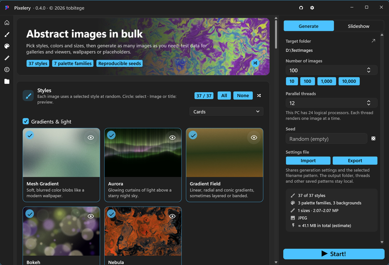

# Pixelery



Mass generator for abstract images: pick styles, colors and sizes, then write hundreds or thousands of images to a folder, for example as test data for galleries and photo viewers such as Flowery Photos. Add your own watermark, run an endless slideshow, or drive everything from the command line.

Built with [Flowery.WinUI](https://github.com/tobitege/Flowery.WinUI) (NuGet) and SkiaSharp.

## Projects

| Project | Purpose |
| --- | --- |
| `Pixelery` | WinUI 3 app (Daisy controls, themes, sizes, 12 languages) |
| `Pixelery.Core` | Generator engine without UI dependencies: styles, palettes, sizes, file name schema, watermarks, encoding, parallel runner |
| `Pixelery.Cli` | `Pixelery.Cli.exe` command line tool: generation, single images, desktop background, screen saver |
| `Pixelery.Core.Tests` | Tests for palette files, settings, safe file names, and Truchet rendering |

## Features at a glance

- 37 styles in six categories, each with its own random variants
- Seven palette families and three background tones
- Multiple choice everywhere: with several options selected, each image picks one at random
- Sizes from aspect ratios × orientations × long edges, plus fixed presets and your own values
- File name schema with placeholders; `\` or `/` creates subfolders
- JPEG, PNG and WebP; optional spread file dates and EXIF date taken / camera model so photo apps can group by date
- Watermarks with any number of text and image layers
- Reproducible: the master seed plus the image index define every image
- Cancellable progress with speed, remaining time and a live thumbnail of the latest image
- Endless slideshow in full screen or a window, nothing saved
- Full command line control, including desktop background and screen saver

## Styles

Every style derives all decisions from the image seed, so the same seed gives the same image again.

| Category | Styles |
| --- | --- |
| Gradients & light | Mesh Gradient, Aurora, Gradient Field (linear, radial, conic, banded), Bokeh, Nebula |
| Geometric | Bauhaus, Truchet, Low Poly, Subdivision (Mondrian or modern tiles), Circle Packing, Memphis, Isometric Cubes, Halftone, Kaleidoscope |
| Organic | Flow Field, Marble, Topographic, Watercolor, Paper Cut, Ridgelines, Stained Glass |
| Procedural | Plasma, Fractal (Julia sets and Mandelbrot close-ups), Harmonograph (and spirographs) |
| Retro & digital | Synthwave, Glitch, Pixel Mosaic, Neon Glow |
| Optical illusions | Op Art, Rotating Snakes, Café Wall, Scintillating Grid (and Hermann grid), Fraser Spiral, Zöllner, Ouchi, Kanizsa, Impossible Figures (Penrose tribars) |

Cards and the preview list use bundled thumbnails at startup. You can regenerate them with the selected colors. The eye button opens a large preview with a full screen view (→ shows more variants, Space runs a slideshow of that style).

## Colors and finish

- **Palette families:** curated (36 hand-picked palettes), color harmony (analogous, complementary, split, triadic, tetradic), cosine gradients, pastel, neon, earth tones, monochrome
- **Background:** dark, light or vivid
- **Level of detail:** low, medium, high
- **Finish:** film grain, vignette

## Dimensions

All selected combinations form a pool; each image picks one size at random.

- **Orientation:** landscape, portrait (for all non-square ratios)
- **Aspect ratios:** 1:1, 5:4, 4:3, 3:2, 16:10, 16:9, 2:1, 21:9, 32:9 and your own (e.g. 7:5 or 1.85)
- **Long edge:** 640 to 7,680 px and your own
- **Fixed dimensions:** presets from Thumbnail to 24 MP, phone, portrait 4:5, square, A4 at 300 dpi, and your own (width × height)

## Output and file names

| Placeholder | Value |
| --- | --- |
| `{n}`, `{n:00000}` | Running number (start number configurable), with zero padding |
| `{style}`, `{category}`, `{palette}` | Style id, style category, palette name (`:upper`, `:lower`, `:title` change the case) |
| `{w}`, `{h}`, `{ratio}`, `{orient}` | Width, height, aspect ratio (e.g. `16x9`, `7x5`), landscape/portrait/square |
| `{seed}` | Image seed (hex, `:d` for decimal) to reproduce the image |
| `{date:yyyy-MM-dd}` | Image date (spread over the past years if enabled), .NET date format |
| `{now:yyyyMMdd_HHmmss}` | Time of the run |
| `{rand:6}`, `{guid}` | Random letters and digits, unique id |
| `{fmt}`, `{total}` | File format, number of images in the run |

Example: `{date:yyyy}\{date:MM}\{style}_{n:00000}` creates year and month folders. The extension is added automatically; existing files are overwritten or get a numeric suffix.

Further options: formats (JPEG, PNG, WebP; several pick at random), quality, spread file dates over N years, EXIF date taken and camera model (JPEG), overwrite existing files.

## Watermarks

Any number of layers, drawn in order on top of every generated image (and optionally in the slideshow). All sizes are relative to the image, so the watermark looks the same on every image size. The editor shows a live preview on a sample image in landscape, portrait or square format.

**Text layers**

| Option | Details |
| --- | --- |
| Text | Several lines; placeholders filled in per image, e.g. `© {now:yyyy} Your Name`, `{style}`, `{seed}`, `#{n}`, `{w}×{h}` |
| Font | Any installed font; bold, italic, uppercase; right-to-left scripts and ligatures are shaped with HarfBuzz |
| Size | Font size in % of the shorter image edge |
| Letter spacing | Extra space between letters |
| Color | Any color with transparency |
| Outline | Color and width |
| Shadow | Color and size |
| Background plate | Color with transparency, padding, corner rounding (up to a pill shape) |

**Image layers**

| Option | Details |
| --- | --- |
| Image | Your logo or signature; PNG with transparency works best |
| Width | In % of the image width |
| Grayscale | Removes the colors |
| Single color (stamp) | Fills the logo with one color, keeping its transparency |
| Shadow | Soft drop shadow |

**For both**

| Option | Details |
| --- | --- |
| Opacity | 0 to 100 % |
| Blending | Normal, multiply, screen, overlay, soft light, difference |
| Position | Fixed (3 × 3 anchor grid), tiled across the whole image, or a random corner per image (harder to crop away) |
| Distance to the edge | For fixed positions and random corners |
| Tile spacing | For tiled watermarks |
| Rotation | −180° to 180° |

## Slideshow

The **Slideshow** tab shows newly generated images one after another with the selected styles and colors, without saving anything.

- Interval in seconds, full screen or window, cross-fade, info overlay (style, palette, seed), seed for a repeatable sequence
- The next image is rendered while the current one is shown, at the window's resolution
- Keys: **Esc** end, **Space** pause, **← →** previous / next, **I** info, **F** or double-click full screen

## Command line

`Pixelery.Cli.exe` (project `Pixelery.Cli`) drives the same engine with the same settings as the app:

In PowerShell, run it as `.\Pixelery.Cli.exe` from the executable's directory.

```bash
Pixelery.Cli.exe generate -o D:\TestImages -n 10000 -j max               # bulk generation with progress and Ctrl+C
Pixelery.Cli.exe generate --app-config -n 500                            # reuse the settings last used in the app
Pixelery.Cli.exe generate -s marble,aurora --palettes neon --tones dark --sizes "4K UHD" --formats png
Pixelery.Cli.exe generate -c my.json --dry-run                           # plan and example file names only
Pixelery.Cli.exe generate -n 500 --watermark-text "© {now:yyyy} Your Name" --watermark-position random
Pixelery.Cli.exe render marble.png -s marble --seed 42                   # one image into a file
Pixelery.Cli.exe setbackground -s aurora,nebula --tones dark             # one image at screen size as desktop background
Pixelery.Cli.exe setscreensaver -s geometric --activate                  # one image for the Windows Photos screen saver
Pixelery.Cli.exe list styles|palettes|sizes|placeholders
Pixelery.Cli.exe <command> --help
```

| Area | Options |
| --- | --- |
| Settings source | `-c/--config <file>`, `--app-config`, `--save-config <file>` |
| Styles and colors | `-s/--styles`, `--exclude`, `--palettes`, `--tones`, `--detail`, `--grain`, `--vignette` (lists are comma separated, `all` selects everything) |
| Sizes | `--orientation`, `--ratios`, `--edges`, `--sizes` (given size options replace the sizes of a loaded configuration) |
| Output | `-o/--out`, `-n/--count`, `-j/--threads` (`max` for all cores), `--seed`, `--formats`, `--quality`, `--name`, `--start`, `--overwrite`, `--spread-dates`, `--spread-years`, `--exif` |
| Watermark | `--watermark`/`--no-watermark`, `--watermark-text`, `--watermark-image`, `--watermark-position`, `--watermark-size`, `--watermark-opacity`, `--watermark-rotation`, `--watermark-color`, `--watermark-font` (everything else, such as several layers, outline, plate or blend modes, via `--config`) |
| Run | `--dry-run`, `-q/--quiet`, `--json` |

Switches can be negated with `--no-…`. Exit codes: 0 done, 1 failures, 2 invalid options, 130 cancelled.

`render`, `setbackground` and `setscreensaver` produce exactly one image and accept the style, color, size and watermark options. Without size options they render at the primary screen resolution. Backgrounds are kept in `%LOCALAPPDATA%\Pixelery\Wallpaper`; each screen saver image gets its own folder under `%LOCALAPPDATA%\Pixelery\Screensaver`.

Developer helpers: `Pixelery.Cli.exe sheet <folder> [seed] [styleId]` (contact sheets) and `Pixelery.Cli.exe bench [w] [h] [n]` (render time per style).

## Build and run

```bash
dotnet build Pixelery.slnx
bin/Debug/Pixelery/net10.0-windows10.0.19041/win-x64/Pixelery.exe
```

Debug builds include [Chrome.DevTools.WinUI](https://github.com/wieslawsoltes/CDP) for UI inspection and automation.
The CDP server starts with the app on loopback port `9225` and stops when the main window closes.
Open `http://127.0.0.1:9225/json/list` to discover the window and its WebSocket endpoint.
Release builds exclude the CDP package and server.

## Release builds

Pull requests and pushes to `main` run Windows CI. It builds the solution, runs the Core tests, and publishes the app and CLI.
The CLI smoke test checks all 37 styles, reproducible PNG output, image dimensions, parallel generation, text watermarks, and settings files.
CI checks that both publish outputs contain native code without a managed runtime.
It builds and tests the NSIS installer, including the shared app/CLI directory, upgrades, and removal.
It uploads test results, the installer, and portable ZIP files, without creating a release or tag.

Run the Core tests locally with `dotnet test Pixelery.Core.Tests/Pixelery.Core.Tests.csproj -c Release`.
Test files stay under `%LOCALAPPDATA%\Pixelery\Tests` unless `PIXELERY_TEST_ROOT` specifies another directory.
The caller owns these test files and can remove them after inspection.

After publishing the CLI, run the smoke test from PowerShell 7:

```powershell
./tools/Test-CliSmoke.ps1 -CliPath ./publish-cli/Pixelery.Cli.exe -OutputDirectory "$env:LOCALAPPDATA/Pixelery/Tests/Smoke"
```

Both projects use Native AOT for Release publishing. The applications need no .NET or Windows App SDK installation.
Building them requires the .NET SDK selected in `global.json` and Visual Studio C++ build tools with a Windows SDK.

```bash
dotnet publish Pixelery/Pixelery.csproj -c Release -r win-x64 -p:Platform=x64 -o publish
dotnet publish Pixelery.Cli/Pixelery.Cli.csproj -c Release -r win-x64 -o publish-cli
```

GitHub releases are created manually: Actions → **Pixelery Release** → Run workflow → version (e.g. `0.1.0`).
The release contains a per-user installer, `Pixelery-Setup-<version>-x64.exe`, and two portable archives: `Pixelery-Windows-x64.zip` and `Pixelery.Cli-Windows-x64.zip`.
The installer needs no administrator rights. Its default directory is `%LOCALAPPDATA%\Programs\Pixelery`.
It offers all 12 application languages and initializes the selected language if no language preference exists.
An existing language preference is kept.
It creates a Start menu shortcut and an uninstall entry for the current user.
The installer always includes both `Pixelery.exe` and `Pixelery.Cli.exe` directly in the installation directory. Shared libraries are installed once.
Upgrades move the previously installed app and CLI out of their separate component folders into this common directory.
Updates and removal preserve application settings and files that the installer did not install.

For a portable installation, use either ZIP.
Extract the complete archive, then run `Pixelery.exe` or `Pixelery.Cli.exe`. Keep all included libraries and assets beside the executable.
Debug symbols are excluded from these archives.

Build the installer from existing publish directories with PowerShell 7:

```powershell
$nsis = ./tools/Get-Nsis.ps1 -Directory "$env:LOCALAPPDATA/Pixelery/Tools"
./tools/New-Installer.ps1 -AppDirectory ./publish -CliDirectory ./publish-cli -OutputDirectory ./artifacts/packages -NsisPath $nsis
```

The helper downloads NSIS 3.13 and verifies the archive against a pinned SHA-256 checksum.
The installer supports `/S` for silent installation. Both applications are always installed.
Only one Pixelery installation or removal can run at a time. A competing process exits with code 1618.
For a custom directory, append `/D=<absolute path>` as the last argument, without quotes around the path.
Its test script requires a clean user account without an existing installed Pixelery.

Settings are stored in `%LOCALAPPDATA%\Pixelery` (override with `PIXELERY_STATE_ROOT`).

## Updates

Open **Settings → Updates** to check for a stable release, download it, and select **Install and restart**.
The app verifies Ed25519 signatures on both the update feed and installer with [NetSparkle](https://github.com/NetSparkleUpdater/NetSparkle).
No update is downloaded or installed in the background. Closing settings cancels a pending check or download.
Installation waits for Pixelery to close, updates both applications, preserves settings, and restarts the app.
If installation fails, the automatic updater displays the error. After you dismiss it, a successful rollback restarts the previous app.
Finish image generation before installing an update.
For portable users, this creates or updates the per-user installation; the extracted portable files remain untouched.
Downloads stay under the application data directory in `Updates`.

The release workflow publishes `appcast.xml` and `appcast.xml.signature` beside the installer and ZIP files.
It requires the repository secret `PIXELERY_UPDATE_PRIVATE_KEY`, containing the NetSparkle Ed25519 private key.
The matching public key is embedded from `Pixelery.Updates/UpdatePublicKey.txt`.
Keep a secure backup of the private key. Replacing it requires a separately planned trust-key migration for existing installations.
PR CI uses disposable test keys and has no access to the release signing key.

To generate a signed feed locally after building the installer:

```powershell
dotnet tool restore
./tools/New-UpdateFeed.ps1 -InstallerPath ./artifacts/packages/Pixelery-Setup-0.2.0-x64.exe -Version 0.2.0 -OutputDirectory ./artifacts/packages -KeyDirectory "$env:LOCALAPPDATA/Pixelery/ReleaseSigning"
```

The update feed becomes available after the next manual GitHub release with these assets.

## License

MIT License. Copyright (c) 2026 by @tobitege. See [LICENSE](LICENSE).

Repository: <https://github.com/tobitege/Pixelery>
